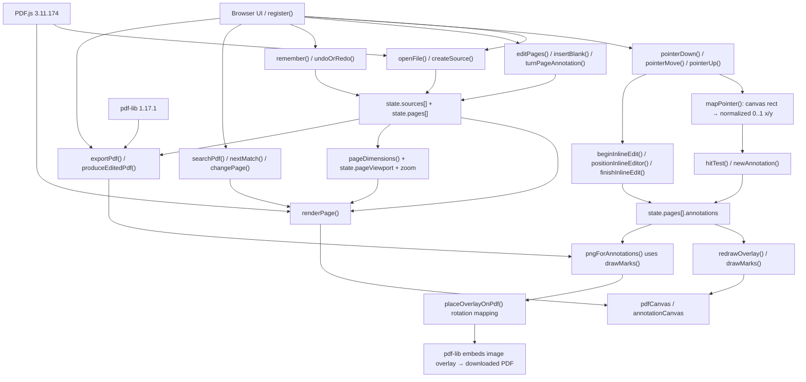

# mypdf — current code architecture and dependency map

**Status:** Verified against the deployed app source (`mypdf/index.html`, version `1.2.0`) on 2026-11-05.

> **Important:** This describes the EXISTING application. The code is presently ONE `index.html` file containing HTML, CSS and JavaScript. The sections below are logical subsystems, **not** already-separated JavaScript files. Do not assume `modules/`, `assets/` or `utils/` exist.

## Runtime dependency diagram

## Source of truth / actual file structure

- `mypdf/index.html` — the complete app: HTML controls, CSS, JavaScript, all functions.
- `mypdf/ARCHITECTURE.md` — this map and the behavioral contracts.
- `mypdf/AGENTS.md` — mandatory change instructions for coding agents.
- `mypdf/REGRESSION_CHECKLIST.md` — manual acceptance tests.
- Published at `https://kamaldeep123.github.io/Additon/mypdf/` from the existing `Additon` repository. Do not change the neighboring website.

## State model

`state.sources[]`: input PDF bytes and PDF.js document handles. Originals are kept for copying into the exported result.

`state.pages[]`: current page order, source indices, rotations and `annotations[]` (text, signature, highlight, pen, box, cover or image). Some pages may be blank.

Other shared state: `current`, `zoom`, `pageViewport`, `selected`, `tool`, `inlineEditing`, `undo`, `redo`, `dirty`.

## Important function contracts

| Area | Existing function(s) | Contract to preserve |
| --- | --- | --- |
| Open | `openFile`, `createSource` | Open local PDF without uploading document to a server. |
| Render | `pageDimensions`, `fitToWidth`, `renderPage`, `redrawOverlay`, `drawMarks` | Overlay aligns with base PDF at every zoom, rotation and device pixel ratio. |
| Touch | `pointerDown`, `pointerMove`, `pointerUp`, `mapPointer` | Use actual on-screen canvas bounding rect. Annotation coordinates remain normalized from 0 to 1, independent of CSS pixel dimensions. |
| Inline text | `beginInlineEdit`, `positionInlineEditor`, `finishInlineEdit`, `recalculateTextHeight` | On iPhone, 16px editing control is a floating UI; actual text placement is shown on the PDF at its real rendered size. Keep tap/cell alignment stable. |
| Existing edits | `hitTest`, `newAnnotation`, `replaceClickedText`, `updateProperty` | Tap an existing user-added text to revise it; tapping adjacent cells must not accidentally edit the previous cell. Replace visibly covers existing PDF text, not true text-layer editing or secure redaction. |
| Pages | `editPages`, `insertBlank`, `turnPageAnnotation`, `changePage` | Maintain source-page references, page order and rotated annotation positions. |
| History | `remember`, `undoOrRedo` | Mutating actions must preserve undo/redo and dirty state. |
| Save | `exportPdf`, `produceEditedPdf`, `pngForAnnotations`, `placeOverlayOnPdf` | Preserve original PDF pages, flatten annotations at exactly the previewed coordinates, handle all four rotation orientations, allow the result to reopen. |

## HIGH-RISK COORDINATE CHAIN

**Touch → `mapPointer()` → normalized `annotations[x,y,w,h]` → `positionInlineEditor()` / `drawMarks()` → `pngForAnnotations()` → `placeOverlayOnPdf()` → saved PDF.**

All of these consume the same physical placement. Do **not** independently add offsets or multiply by DPI in one layer. The base canvas has CSS dimensions and a DPR-scaled backing buffer. Validate any new coordinate math on both iPhone Safari and desktop, with zoom, long text, tight table cells, rotation and save/reopen.

## Before merging a change

1. Read `AGENTS.md` and `REGRESSION_CHECKLIST.md`.
2. Identify affected functions above and the callers/dependents, as well as unrelated behaviors that must stay intact.
3. Keep changes small. Do not refactor architecture, upgrade libraries, delete features, or alter the GitHub Pages path without explicit approval.
4. Add a regression test for the new behavior and run all existing relevant tests, including iPhone touch placement and saved PDF output.
5. Inspect the diff; if this diagram/function map changed, update these docs in the same commit. Obtain approval before merging incompatible changes.

**A map is a guide, not a guarantee:** automated browser tests and acceptance testing are required to detect regressions.
